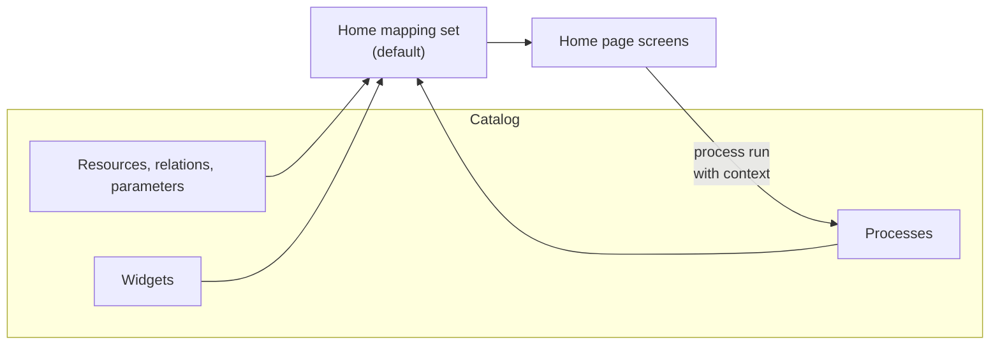

The Home page is the workspace for developers and system owners in Deckhouse Development Portal (DDP, portal).
It brings together teams, systems and their integrations, microservices, environments, deployments, shared resources, and cluster resource consumption.
From the Home page, users create microservices from templates, deploy them to environments, order resources, and upgrade microservices to new template versions.


The Home page is a Preview feature.
The set of sections, the structure of mapping rules, and the API may change in future releases without backward compatibility.


For a description of the screens from the user's perspective, see the Home page user guide.

## How it works

The Home page does not store its own data.
All objects it displays are catalog entities, and all actions are catalog processes.
Mapping rules define which resources, relations, properties, processes, and widgets to use.

Mapping rules map catalog objects to Home page concepts:

- **Resource role**: A catalog resource whose entities the Home page displays as systems, microservices, environments, and so on.
- **Relation role**: A catalog relation the Home page uses to find, for example, the microservices of a system or the environment of a deployment.
- **Property role**: The ID of an entity property from which the Home page reads, for example, the microservice language or the environment domain.
- **Action slot**: Processes run from the Home page with a button or menu item, for example, "Create environment".
- **Template action**: A process that performs an action on a microservice created from a specific template.
- **Widget slot**: A widget that the Home page displays in a fixed place on the screen.

The diagram below shows how catalog data reaches the Home page screens:

Roles are not tied to specific resource IDs, so the Home page can be connected to any catalog model that contains the required resources and relations.
A ready-made catalog model and mapping rules for it are created by the "Canonical architecture (schema)" dataset, which is applied by the [initial setup wizard](setup/).

For the full list of roles, slots, and rules for filling them in, see [Mapping rules](mapping/).

## Default mapping set

Mapping rules are stored in Home mapping sets.
The portal can contain several sets, but the Home page uses only one — the default set.

The Home page selects a set in the following order:

1. The set with the "Default for Home" toggle enabled.
1. The set with the `home-default` ID.
1. The first set in the list.

Only one set can be the default set.
When another set becomes the default set, the flag is automatically cleared on the previous one.
The default set cannot be deleted.

Mapping rules apply to all portal users. Users cannot select a different set on the Home page.

## Enabling the Home page

The Home page is disabled after the portal is installed.
The "Home" tab is hidden for all users, and Home page URLs redirect to the catalog.

To enable the Home page:

1. Go to "Administration" → "Directories" → "Mapping rules".
1. Enable the "Show Home" toggle.

The toggle takes effect immediately for all users. Changing it requires the `update:home-mapping-sets` permission.

When the Home page is enabled, users see the "Home" tab in the top bar, and clicking it opens the "Teams" section.


The "The platform is ready for setup" banner, from which the initial setup wizard is launched, is displayed on the Home page.
While the Home page is disabled, the wizard is available only in "Administration" → "Directories" → "Datasets".


## Home page sections

Home page sections are grouped in the side menu.
Each section requires its own mapping roles; if the section's main role is not mapped to a catalog resource, the section displays the message "Configure mapping rules or apply the 'Canonical architecture' dataset".

The table lists the sections, their main resource roles, and action slots:

| Group | Section | Resource roles | Action slots and template actions |
| --- | --- | --- | --- |
| Organization | "Teams" | Portal teams; `system`, `microservice` | — |
| Architecture | "Systems" | `system`, `microservice`, `shared_resource`, `deployment`, `environment`, `cluster`, `integration` | — |
| Architecture | "Integrations" | `system`, `integration` | — |
| Architecture | "Diagrams" | `system`, `microservice`, `shared_resource` | — |
| Architecture | "Clusters and networks" | `cluster`, `environment` | — |
| Architecture | "How the platform works" | `guide` | — |
| Development | "Create microservice" | `system`, `vcs_namespace` | "Create microservice" template action |
| Development | "Microservices" | `microservice`, `system`, `shared_resource`, `deployment`, `environment`, `cluster` | "Upgrade microservice from template" template action; widget slots for the "Pipelines" and "MRs" tabs |
| Development | "System deployment" | `system`, `microservice`, `environment`, `shared_resource`, `ingress`, `deployment` | `deploy_microservice`, `delete_microservice`, `order_resource`, `connect_shared_resource`, `disconnect_shared_resource`, `delete_shared_resource`; "Deploy microservice to an environment" and "Delete microservice from an environment" template actions |
| Development | "Resource ordering" | `shared_resource`, `system` | `order_resource`, `delete_shared_resource` |
| Development | "Environments" | `environment` | `create_environment`, `delete_environment` |
| Development | "Resource consumption" | `deployment` | — |

The "DORA and SDLC metrics", "Operating costs", "Platform adaptation", "System requirements", "Build and delivery", and "Troubleshooting hub" sections and all sections of the "Security" group are marked "TBD" in the menu.
Opening such a section displays the message "This section is not available yet".

## Access permissions

The Home page uses the common portal role model.
There is no separate role for the Home page.
What a user can see and do is determined by their permissions on entities, processes, and Home page settings.

The table lists the permissions that affect how the Home page works:

| Permission | Where it is used |
| --- | --- |
| `read:entities` (global or on a resource) | Loading entities for all sections. If a resource's entities are not available to the user, the section looks the same as with an unmapped role |
| `read:processes` | Loading action slot processes. A process that is not available to the user is not displayed in the slot |
| `control:processes` (global, on a resource, or on an entity) | Running processes from the Home page. Run buttons are not disabled; without the permission, the portal returns the "Forbidden by RBAC" error |
| `update:entities` or the `update:entity` permission on an entity | Changing the environment domain in the "Environments" section |
| `run:actions` on the microservice entity | The "Upgrade" button on the microservice card |
| `read:template-packs` | The template gallery in the "Create microservice" section and the new template version notification on the microservice card |
| `read:template-registries` | Notifications about prerelease template versions on the microservice card |
| `update:home-mapping-sets` | The "Show Home" and "Configure mapping" toggles, changing mapping rules |
| `create:home-mapping-sets`, `delete:home-mapping-sets` | Creating and deleting Home mapping sets |
| `apply:seeds` | The "The platform is ready for setup" banner and the initial setup wizard |

No separate permission is required to view the Home page.
The "Home" tab is available to all users if the Home page is enabled.


The "Developer" role preset does not include the `read:entities` permission.
For developers to see data on the Home page, grant them access to the entities of the required resources through resource roles, or add the `read:entities` permission to their role.


For more information about permissions, see [Role model](../security/rbac/).

## Setup procedure

To prepare the Home page for use, follow these steps:

1. Apply the datasets with the [initial setup wizard](setup/) or configure [mapping rules](mapping/) for your own catalog model.
1. Enable the "Show Home" toggle.
1. Connect the [template registry](../templates/registry/) and bind processes to templates in the "Template actions" block.
1. If necessary, add your own processes to action slots.
   Requirements for such processes are described in [Home page processes](processes/).

For a step-by-step scenario, see the [Home page quick start](../examples/home-quick-start/) example.
