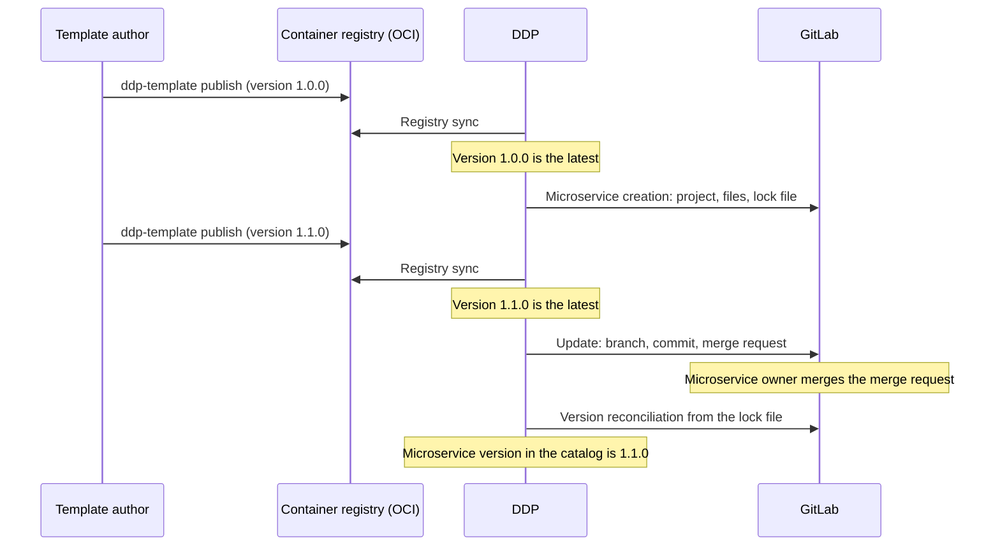

Microservice templates define the repository structure of a new microservice: boilerplate code, CI/CD, deployment manifests, and configuration.
Deckhouse Development Portal (DDP) creates a microservice repository from a template, and when a new template version is released, it carries the changes over to the repository through a merge request.


The template registry and upgrading from a template are Preview features.
The pack format, the set of settings, and the API may change in future releases without backward compatibility.


## Key concepts

The template mechanism uses the following concepts:

- **Template pack**: A directory with the `template.yaml` manifest, the `values.yaml` parameter schema, and files written as Go templates.
  The pack is published to a container registry as an OCI artifact; the pack version is the artifact tag in semver format.
- **Template registry**: The portal's connections to container registries where packs are published.
  The portal synchronizes the registry on a schedule and maintains a catalog of template versions.
- **Latest version**: The recommended template version, that is, the highest stable version among the available ones.
  The creation wizard offers it, and microservices are upgraded to it.
- **Lock file**: The `.ddp/template.lock.yaml` file in the microservice repository.
  It stores the template identifier, its version, and the parameter values the repository was created with.
- **Microservice-to-template binding**: Properties of the microservice entity in the catalog: the template identifier, version, registry, and upgrade policy.
- **Template actions**: Processes for creating, deploying, removing from an environment, and upgrading, bound to a specific template in the Home page mapping rules.

## Template lifecycle

The diagram below shows the path from publishing a template to upgrading a microservice repository:

Lifecycle stages:

1. The template author prepares a pack and publishes a version with the `ddp-template` utility.
   The pack format is described in [Template pack](packs/).
1. The portal synchronizes the [template registry](registry/) and adds the version to the version catalog.
1. The administrator binds processes to the template in the "Template actions" block of the [mapping rules](../home/mapping/#template-actions).
1. A developer creates a microservice in the "Create microservice" Home page section.
   The creation process creates a GitLab project, writes the rendered template files and the lock file to it, and registers the microservice in the catalog.
1. When a new template version is released, the portal shows the "Version {version} is available" notification on the microservice card.
   The upgrade is started with the "Upgrade" button or automatically.
1. The upgrade process creates a branch with the template changes and opens a merge request.
   After the merge request is merged, the portal updates the microservice's template version in the catalog.

The upgrade mechanism is described in detail in [Upgrading from a template](updates/).

## Participant roles

Different participants work with templates:

| Participant | Tasks | Documentation |
| --- | --- | --- |
| Template author | Prepares the pack, selects the upgrade strategy, publishes versions | [Template pack](packs/) |
| Portal administrator | Connects container registries, configures synchronization and automatic upgrades, binds processes to templates | [Template registry](registry/), [Mapping rules](../home/mapping/#template-actions) |
| Developer | Creates a microservice from a template, merges the upgrade merge request | "Microservices" in the user guide |

## Limitations

The template mechanism has the following limitations:

| Limitation | Description |
| --- | --- |
| Pack storage | Only container registries with OCI Distribution Spec v2, for example, Harbor, GitLab Container Registry, and Docker Registry |
| Version control system | Only GitLab. The microservice repository is accessible over HTTPS on the GitLab external service host |
| Versions | Only strict semver without the `v` prefix, for example, `1.2.0`. A published version cannot be overwritten |
| File deletion | The upgrade does not delete files from the repository. Files deleted or renamed in a new template version are deleted manually |
| Intermediate versions | The upgrade moves the repository directly to the latest template version; intermediate versions are not applied one by one |
| Merging | The portal does not merge the upgrade merge request automatically |
| Registry binding | A microservice is upgraded only from the registry it was created from. If the latest template version comes from another registry, no upgrade is offered to the microservice |
| Microservices without a lock file | Repositories created without the `.ddp/template.lock.yaml` lock file cannot be upgraded from a template |
| New templates | For each new template, processes are bound manually in the Home page mapping rules |


The [Automatic service upgrades](../../examples/service-autoupdates/) example describes configuring upgrades based on actions, automations, and template Git tags without the template registry.
The mechanism described in this section works with template packs from an OCI registry and is configured without custom automations.

